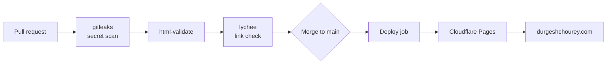

# durgeshchourey.com

[](https://github.com/choureydurgesh/durgeshchourey/actions/workflows/site.yml)

The personal portfolio of **Durgesh Chourey**, a DevOps, Platform and DevSecOps engineer with 10+ years of Linux and C++ in regulated embedded systems.

**Live:** [durgeshchourey.com](https://durgeshchourey.com)

The site is small on purpose. It's a static page delivered through the same gated pipeline I'd use for a production service.

## What's in it

- **Case studies:** six projects with their architecture, my contributions and the stack, including [BelastingBuddy](https://github.com/choureydurgesh/belastingbuddy), a DevSecOps and GitOps platform, and [KlaarVoorNL](https://www.klaarvoornl.com).
- **Experience:** ten years across ASML, Canon, Philips, Kverneland, Alstom, Lely and GE HealthCare.
- **Skills, education and contact.**

## How it's built

| | |
|---|---|
| Markup | One `index.html`, with all content in the HTML for search engines and link previews |
| Styling | Plain CSS with design tokens and light/dark themes; no framework, no build step |
| Script | `main.js` handles the theme toggle, case-study filter, dialogs and copy-email. The page reads fine without it |
| Fonts | Inter and JetBrains Mono (Google Fonts) |
| Hosting | Cloudflare Pages, DNS on Cloudflare |
| Privacy | No cookies, no analytics, no tracking |

## How it ships

Every change goes through a pull request. Nothing reaches production unless the checks pass.



| Stage | Tool | Fails the build when |
|---|---|---|
| Secret scan | [gitleaks](https://github.com/gitleaks/gitleaks) | a credential is committed anywhere in the history |
| HTML validation | [html-validate](https://html-validate.org) | markup is invalid or inaccessible (labels, heading order, ARIA) |
| Link check | [lychee](https://github.com/lycheeverse/lychee) | any link on the page is broken |
| Deploy | [wrangler](https://developers.cloudflare.com/workers/wrangler/) | runs only on `main`, and only after the checks pass |

The workflow is [`.github/workflows/site.yml`](.github/workflows/site.yml). It runs with read-only repository permissions, and the deploy step is skipped cleanly if Cloudflare credentials aren't configured.

## Run it locally

```sh
npx serve .
# open http://localhost:3000
```

Run the same checks as CI:

```sh
npx html-validate index.html
docker run --rm -v "$PWD":/repo zricethezav/gitleaks git /repo
```

## Deploy setup

The deploy job needs two repository secrets (**Settings → Secrets and variables → Actions**):

| Secret | Value |
|---|---|
| `CLOUDFLARE_API_TOKEN` | A Cloudflare API token with only the **Account · Cloudflare Pages · Edit** permission |
| `CLOUDFLARE_ACCOUNT_ID` | The Cloudflare account ID |

The custom domains (`durgeshchourey.com` and `www`) are attached to the `durgeshchourey` Pages project in the Cloudflare dashboard.

## Repository layout

```
.
├── index.html                  # the page
├── styles.css                  # design tokens, layout, light/dark themes
├── main.js                     # small progressive enhancements
├── assets/                     # images, favicon, link-preview image
└── .github/workflows/site.yml  # checks + deploy
```

## Contact

[LinkedIn](https://www.linkedin.com/in/durgeshchourey) · [djchourey@gmail.com](mailto:djchourey@gmail.com) · Helmond, Netherlands

---

© Durgesh Chourey. The content and design are not licensed for reuse.
